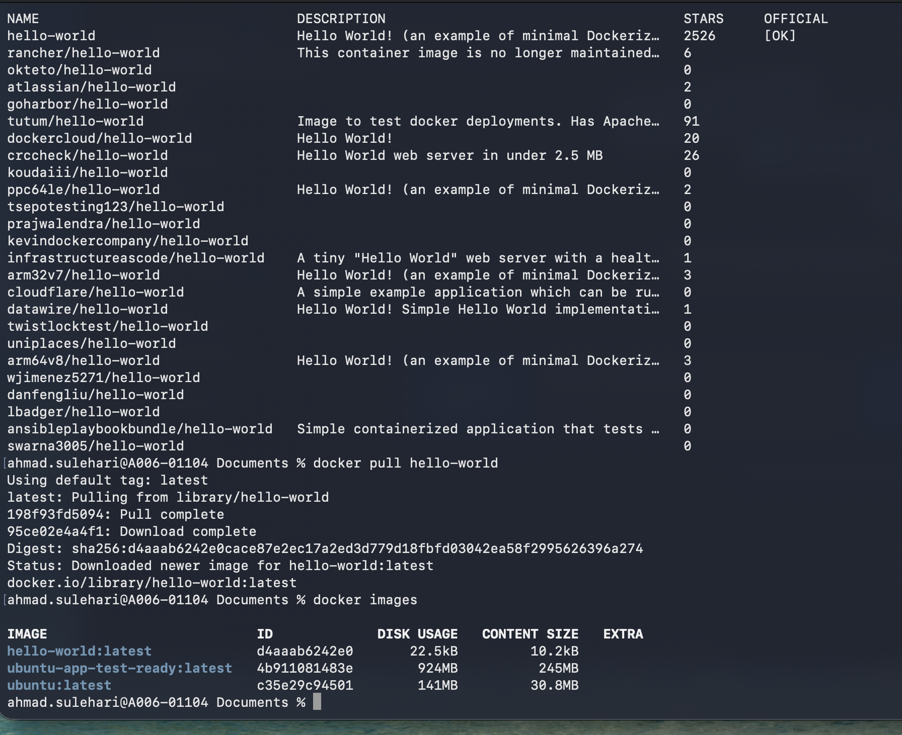
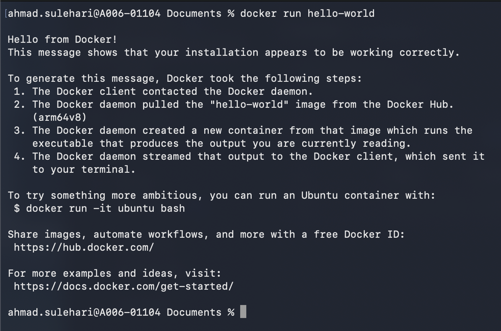
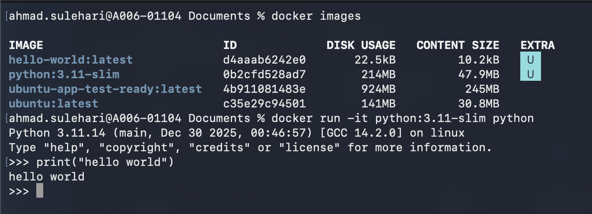
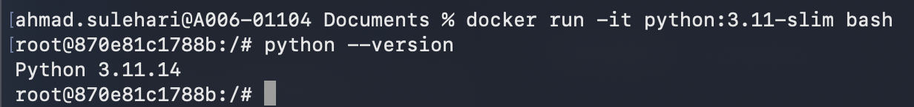
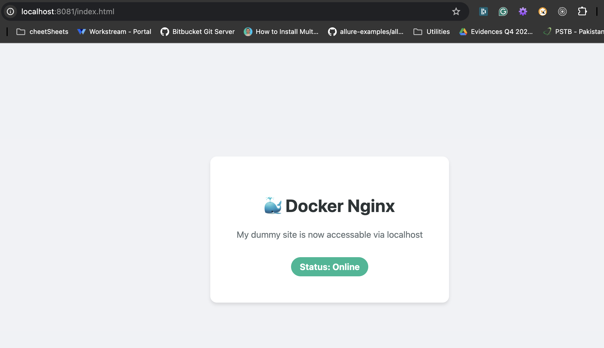
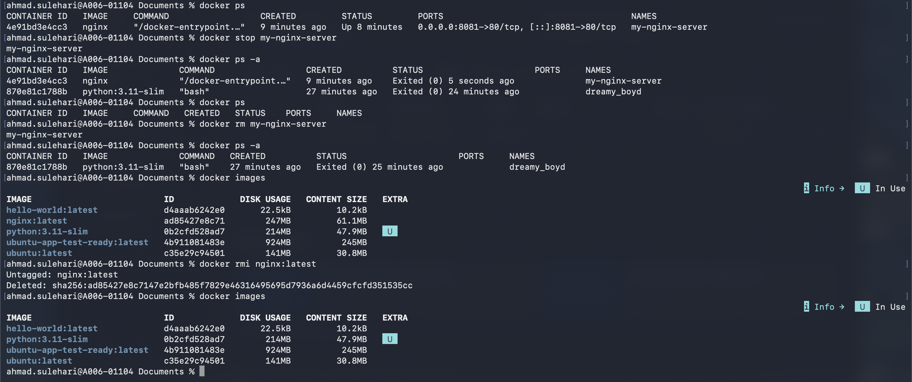

- created a container from base ubuntu image and attached interactive session with it
`docker run -it ubuntu /bin/bash`

- exit the main process and the container also exited
- list all containers running and stopped with command
`docker ps -a` or only running ones with `docker ps`

## restarted container with command
 `docker start -a containerid`
- -a for attaching terminal to the container

## copying files
- installed python, pip and copied files from local machine to docker container
`cp /path/to/files container-name:/path/to/destination`

## creating image from a container
- saved the updated container as a new image
`docker commit container-name new-image-name`

## clean up of stopped containers

- pulled hello-world from docker hub

- pulled python image and created a container with python process as main process

- running python --version command inside the container

# nginx dummy test site

## command used
 `$ docker run --name my-nginx-server -v /Users/ahmad.sulehari/Documents/static-html:/usr/share/nginx/html:ro -p 8081:80 -d nginx`
- --name is for giving a custom name to the container
- -v is use to mount a directory from host to the container file system which in this case is the folder where nginx looks for html content
- -p is used to map the host port 8081 to port 80 of the container on which nginx runs by default
- -d flag is use to run a container in the background

## clean up

- docker stop : to stop the running container
- docker rm : to remove the container
- docker rmi: to remove the image
