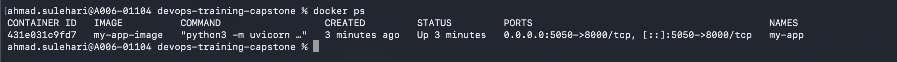
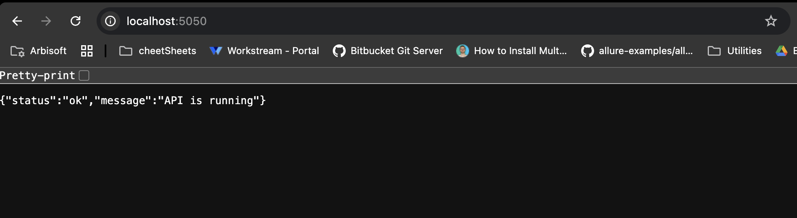

## running container my-app

## accessible via local host and post 5050


```Dockerfile
FROM python:3.11-slim

WORKDIR /app

COPY ./app/main.py /app

COPY ./app/requirements.txt /app

RUN pip install -r requirements.txt

EXPOSE 8000/tcp

ENTRYPOINT ["python3", "-m", "uvicorn", "main:app"]
CMD ["--host", "0.0.0.0", "--port", "8000"]

```
