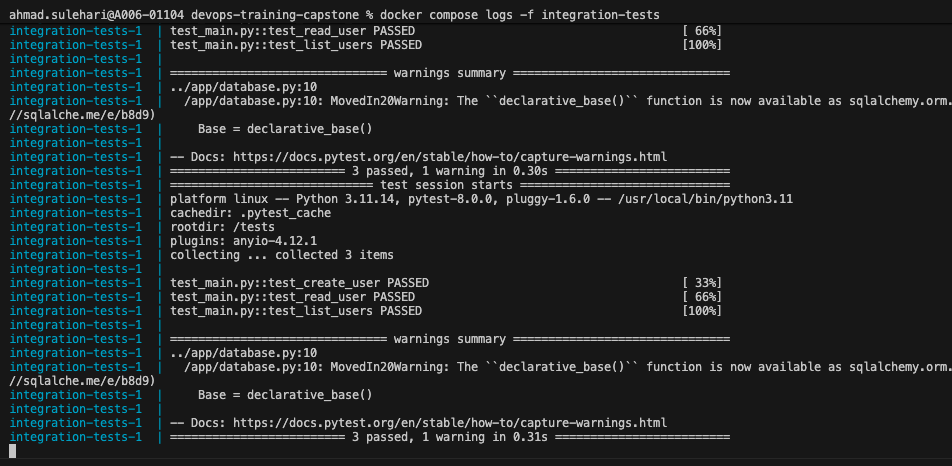

## to run all services in a compose file
`docker compose up`

- -d flag to run in background
- <service-name> to run a specific service

## stop and remove service containers

`docker compose stop`
`docker compose down`

## to inspect a crashing container

`$ docker compose run --rm <service-name> bash`

the --rm flag is used to make sure the container will be removed on exit

## to build only a specific service without touching other

If service has a depends_on section, Docker might try to check those dependencies too. To be 100% sure you aren't touching anything else, we can add the --no-deps flag:

`docker compose up -d --build --no-deps <service-name>`

- Zero Downtime for others: Your database stays online, so you don't lose connections or transient data.
- Docker only evaluates the build context for the one service you've changed
- It only recreates the container if the image actually changed during the build.

## to view logs

`docker compose logs -f <service-name>`

